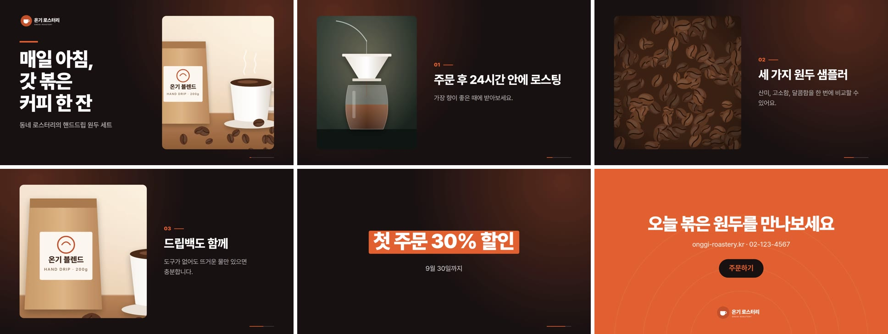
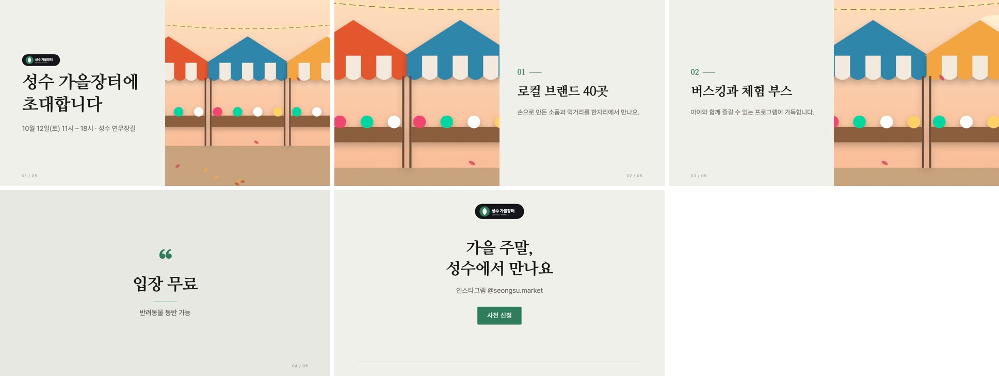

# 모션 스튜디오 (MVP)

영상 편집 경험이 없는 소상공인·마케터·콘텐츠 제작자가 **문구와 사진만 넣고 15~30초 홍보 영상(1920×1080 MP4)** 을 완성하는 웹앱입니다.
목표는 "기능이 많은 편집기"가 아니라 "처음 쓰는 사람이 좋은 결과물을 빠르게 얻는 도구"입니다.



| 클린 에디토리얼 | 팝 컬러 |
|---|---|
|  |  |

샘플 출력 영상: [`examples/bold-product.mp4`](examples/bold-product.mp4) · [`examples/minimal-event.mp4`](examples/minimal-event.mp4) · [`examples/pop-service.mp4`](examples/pop-service.mp4)

---

## 실행 방법

필요한 것: **Node.js 20 이상** (ffmpeg는 npm 패키지로 함께 설치되므로 따로 설치하지 않아도 됩니다)

```bash
cd motion-studio
npm install
npm run dev          # 개발 모드: http://localhost:5173 을 브라우저(Chrome/Edge 권장)로 엽니다
```

- `npm start` — 빌드 후 서버 하나로 실행 (http://localhost:5174)
- `npm test` — 핵심 로직 단위 테스트 (줄바꿈, 이미지 비율, 타이밍, 모션 매핑, 색 대비, 레이아웃 겹침)
- `npm run verify` — `npm run dev` 실행 중에 실제 앱을 브라우저로 조작해 완료 기준 전체를 검사 (결과: `test-output/`)
- `npm run examples` — 템플릿별 샘플 영상 다시 만들기 (결과: `examples/`)
- `npm run samples` — 샘플 이미지 다시 그리기

저장 위치: 프로젝트 `data/projects/*.json`, 업로드 이미지 `data/assets/`, 내보낸 영상 `data/exports/` (`DATA_DIR` 환경변수로 변경 가능)

## 사용 흐름

1. **처음 화면** — "샘플로 바로 체험하기"(회원가입 없음) 또는 "내 자료로 새로 만들기", 최근 프로젝트 다시 열기
2. **목적 선택** — 제품 소개 / 행사 안내 / 서비스 홍보
3. **자료 입력** — 브랜드 이름, 제목, 한 줄 소개, 설명(한 줄 = 한 장면), 강조 문구, 마지막 장면 문구·버튼·연락처, 사진, 로고(선택), 브랜드 색. "샘플 자료 채우기" 제공
4. **스타일 선택** — 입력한 자료로 **실제로 움직이는 예시 3개**를 보여 주고 고르게 함
5. **자동 구성** — 도입 → 핵심 내용(1~3) → 강조 → 행동 유도 장면으로 배치, 권장 영상 길이 자동 설정
6. **편집 화면** — 큰 미리보기(재생·일시정지·구간 탐색) + 장면 카드(끌어서 순서 변경, 추가·복제·삭제) + 수정 패널
   - 선택한 장면: 문구, 사진 선택/업로드, **잘리는 위치(초점 클릭·확대)**, 장면 길이(짧게/보통/길게)
   - 영상 전체: 스타일, 브랜드 색, 움직임(차분하게/부드럽게/경쾌하게), 속도(느리게/보통/빠르게), 강조(약하게/보통/강하게), 영상 길이(15~30초), 브랜드 이름, 로고
   - 실행 취소/다시 실행(Ctrl+Z / Ctrl+Shift+Z), 자동 저장(+Ctrl+S), 스페이스바 재생
   - 글이 넘치거나 읽을 시간이 모자라면 경고와 해결 버튼(장면 나누기, 영상 길이 늘리기)
7. **MP4로 저장** — 진행률(준비 → 프레임 그리기 → MP4 묶기), 남은 시간, 실패 시 원인·해결 안내·다시 시도, 완료 후 바로 재생·다운로드

타임라인·키프레임·그래프 편집기는 노출하지 않습니다.

---

## 기술 선택

### 미리보기·MP4 출력 방식 비교

| 방식 | 장점 | 단점 | 판단 |
|---|---|---|---|
| **캔버스 2D 공용 렌더러 + 서버 ffmpeg (채택)** | 미리보기와 출력이 **같은 함수·같은 폰트·같은 브라우저**로 그려져 레이아웃·움직임 일치. 프레임 단위 결정적 렌더링. 무료 | 프레임을 서버로 보내는 비용(로컬이라 문제 없음) | ✅ |
| DOM/CSS 애니메이션 + 화면 녹화 | 만들기 쉬움 | 실시간 타이밍에 의존 → 프레임 누락, 출력 불일치 | ✗ |
| Remotion (React 기반 영상) | 생태계 좋음 | 일정 규모 이상 회사는 **유료 라이선스** 필요 | ✗ (도입 전 확인 필요) |
| ffmpeg.wasm (브라우저 안 인코딩) | 서버 불필요 | 느림, 30MB 이상 다운로드, 메모리 부족 위험 | ✗ |
| WebCodecs + mp4 muxer | 빠름, 서버 불필요 | 브라우저 빌드마다 H.264 인코더 유무가 다름 (Chromium 오픈소스 빌드 등) | 이후 "빠른 경로"로 추가 가능 |

### 브라우저와 서버의 역할

| 브라우저 | 로컬 Node 서버 (`server/`) |
|---|---|
| 입력·편집 UI, 한글 줄바꿈과 레이아웃 계산, 미리보기 재생 | 프로젝트 JSON 저장/불러오기, 이미지 업로드 저장 |
| 폰트·이미지 로드 완료 확인 후 원본 해상도(1920×1080) 프레임 그리기 → JPEG | 받은 프레임을 순서대로 ffmpeg(libx264, CRF 18, yuv420p, faststart)로 인코딩 |
| 진행률 표시, 실패 시 재시도 | ffprobe로 결과(해상도·길이·코덱) 확인 후 반환, 멈춘 작업 자동 정리 |

### 일치(미리보기 = 출력)를 보장하는 장치

- `src/core/renderer.ts`의 `renderFrame(ctx, project, t)` 하나로 모든 프레임을 그림. 미리보기는 같은 벡터 연산을 배율(scale)만 바꿔 호출
- 렌더링은 **시간 t만의 함수**(난수·현재 시각 없음). 배경 장식의 흔들림도 `sin(t)` 기반
- 레이아웃은 로드된 이미지가 아니라 **프로젝트에 기록된 이미지 크기**로 계산 → 로딩 전후 배치 동일
- 한글 폰트(Pretendard·나눔명조·검은고딕)를 `FontFace`로 **명시적으로 전부 로드**하고, 로드 뒤 글자 폭 측정 캐시를 새로 만듦. 내보내기 전에는 폰트와 모든 이미지 로드를 다시 확인하고, 실패하면 렌더링하지 않고 안내
- 검증: 출력 MP4에서 뽑은 프레임과 미리보기 프레임의 PSNR이 43~55dB(사실상 동일)

---

## 프로젝트 구조

```
motion-studio/
├─ src/core/            # 화면(React)과 무관한 엔진 — Node에서도 테스트 가능
│  ├─ types.ts          # 프로젝트 데이터 모델
│  ├─ formats.ts        # 영상 규격(현재 1920×1080). 세로/정사각형은 여기에 추가
│  ├─ motion.ts         # 움직임/속도/강조 → 곡선·시간·거리 (단일 지점)
│  ├─ timing.ts         # 장면 타이밍, 읽기 시간, 권장 길이
│  ├─ text.ts           # 한글 줄바꿈(띄어쓰기·구절 우선·금칙), 글자 크기 결정
│  ├─ imageFit.ts       # 찌그러짐 없는 cover 자르기(초점·확대)
│  ├─ color.ts          # 브랜드 색 → 팔레트, 대비 보정
│  ├─ compose.ts        # 입력 자료 → 장면 자동 구성, 장면 나누기
│  ├─ assistant.ts      # 문구·구성 도우미 인터페이스 (AI 확장 지점)
│  ├─ renderer.ts       # 결정적 프레임 렌더러 (미리보기·출력 공용)
│  └─ templates/        # 템플릿: bold(임팩트 다크), minimal(클린 에디토리얼), pop(팝 컬러)
├─ src/app/             # React UI (홈, 마법사, 편집기, 내보내기)
├─ server/              # Express: 저장·업로드·ffmpeg 인코딩
├─ public/fonts, public/samples   # OFL 한글 폰트, 직접 제작한 샘플 이미지
├─ scripts/             # verify(E2E 검증), export-examples, make-samples
├─ tests/               # 단위 테스트 + 검증용 극단 비율 이미지
└─ examples/            # 샘플 출력 영상
```

### 프로젝트 데이터 (템플릿과 사용자 데이터 분리)

프로젝트 JSON에는 **사용자 데이터와 템플릿 id만** 저장됩니다. 레이아웃·모션 규칙은 코드의 템플릿 모듈에 있으므로, 템플릿을 바꿔도 문구·사진·잘림 위치는 그대로 유지됩니다.

```jsonc
{
  "version": 1, "id": "prj_…", "name": "매일 아침, 갓 볶은 커피 한 잔",
  "purpose": "product", "templateId": "bold", "format": "landscape", "fps": 30, "duration": 25,
  "brandName": "온기 로스터리", "colors": { "primary": "#E0602F", "accent": "#F5C04A" },
  "motion": { "feel": "smooth", "speed": "normal", "emphasis": "normal" },
  "logoId": "s_logo_onggi",
  "assets": { "s_coffee_hero": { "url": "/samples/coffee-hero.jpg", "width": 1800, "height": 1200, … } },
  "scenes": [
    { "id": "scene_…", "kind": "intro", "title": "…", "body": "…", "imageId": "s_coffee_hero",
      "crop": { "focusX": 0.5, "focusY": 0.5, "zoom": 1 }, "length": "normal" },
    { "kind": "feature", … }, { "kind": "highlight", … }, { "kind": "cta", "button": "주문하기", … }
  ]
}
```

불러올 때 `normalizeProject()`가 누락 값·범위를 보정하므로 버전이 올라가도 이전 파일을 열 수 있습니다.

---

## 결과물 품질 규칙 (모든 템플릿 공통)

| 항목 | 구현 |
|---|---|
| 시각적 위계 | 제목(78~150px) > 강조(색 상자·별·인용 부호) > 본문(35~46px) > 보조 표시. 제목은 굵기·글꼴로 본문과 분리 |
| 여백·정렬 | 안전 여백 좌우 128px·상하 104px, 텍스트는 한 기준선(왼쪽 또는 가운데) 정렬 |
| 가독성 | 1080p 기준 본문 최소 35px, 줄 간격 1.45~1.65, 본문 최대 4줄 |
| 노출 시간 | 글자 수 기반 읽기 시간(초당 12자 + 여유) 보장. 영상 길이를 줄여 부족하면 경고 |
| 가속·감속 | 모든 요소가 같은 `enter()` 함수와 곡선 사용 (아래 표) |
| 전환 통일 | 템플릿마다 한 가지 전환을 영상 전체에 사용 (색 패널 / 겹침 / 원형) |
| 사진·글 분리 | 사진 영역과 글 영역을 겹치지 않게 분할(테스트로 검증). 글을 사진 위에 올리지 않음 |
| 색·움직임 일관성 | 브랜드 색 2개 → 템플릿 팔레트 자동 생성, 어떤 색이든 글자 대비 3:1 이상으로 보정(테스트로 검증). 로고가 배경에 묻히면 받침판 자동 표시 |
| 긴 글 | ① 띄어쓰기·쉼표 구절 단위 줄바꿈 → ② 한 단계만 작게(최소 크기 이상) → ③ 배치 변경(사진 영역 축소) → ④ 넘치면 경고 + "장면 두 개로 나누기". 무조건 작게 줄이지 않음 |
| 사진 비율 | 비율 유지 cover 자르기 + 초점/확대로 잘리는 위치 조절. 템플릿이 사진 비율에 맞춰 틀 모양 조정 |

### 쉬운 선택지 → 실제 애니메이션 값 (`src/core/motion.ts`)

| 움직임 | 곡선 | 요소 등장 시간 | 요소 간 간격 | 장면 전환 |
|---|---|---|---|---|
| 차분하게 | ease (0.25,0.1,0.25,1) — 긴 감속 | 1.00초 | 0.18초 | 0.90초 |
| 부드럽게 | expo-out (0.16,1,0.3,1) | 0.85초 | 0.13초 | 0.75초 |
| 경쾌하게 | back-out(오버슈트 1.5) — 살짝 튕김 | 0.65초 | 0.09초 | 0.60초 |

| 속도 | 모든 시간 값에 곱함 | | 강조 | 이동 거리 | 시작 배율 | 사진 확대(켄 번즈) |
|---|---|---|---|---|---|---|
| 느리게 | ×1.35 | | 약하게 | 28px | 0.985 | 3.5% |
| 보통 | ×1.00 | | 보통 | 64px | 0.95 | 7% |
| 빠르게 | ×0.72 | | 강하게 | 130px | 0.88 | 12% |

등장 애니메이션은 초 단위로 고정되고, 영상 길이를 바꾸면 **머무는 시간만** 달라집니다.

---

## 확장 방법

- **새 템플릿**: `src/core/templates/`에 `Template` 인터페이스(`palette`, `layout`, `drawScene`, `drawTransition`)를 구현하고 `templates/index.ts`에 한 줄 추가. 공용 도구(`kit.ts`: 텍스트 줄 등장, 사진 틀, 로고, `transitions.ts`)를 쓰면 규칙이 자동으로 맞춰집니다.
- **세로(1080×1920)·정사각형**: `formats.ts`의 `FORMATS`에 규격 추가 → 각 템플릿 `layout()`에서 `env.format.orientation` 분기 작성(좌우 분할 → 상하 분할). 렌더러·타이밍·내보내기는 규격 값을 그대로 사용하므로 수정이 필요 없습니다.
- **생성형 AI(문구 작성·장면 구성 제안)**: `src/core/assistant.ts`의 `ContentAssistant`를 구현한 모듈을 추가(예: 서버에 `/api/ai/*`를 두고 API 키는 서버 환경변수로만 보관). UI는 인터페이스만 호출하므로 교체가 쉽습니다. 현재 규칙 기반 구성만으로 전체 흐름이 동작하며, 외부 유료 서비스·API 키는 사용하지 않습니다.
- **빠른 내보내기**: WebCodecs(H.264)를 지원하는 브라우저에서는 서버 없이 인코딩하는 경로를 `exporter.ts`에 추가할 수 있습니다(프레임 렌더러는 그대로).

---

## 검증 결과 (이 저장소에서 직접 실행)

`npm test` — 단위 테스트 10개 통과. `npm run verify` — 세 템플릿 각각에서 아래 항목을 실제 브라우저로 확인:

- 샘플로 시작 → 스타일(움직이는 예시 3개) → 영상 만들기 → MP4 저장까지 완료
- 한글 입력(IME 조합 입력 시뮬레이션 포함)·수동 줄바꿈, 실행 취소/다시 실행(버튼·단축키), 브랜드 색·영상 길이 변경
- 세로형(900×1800)·가로형(3000×1000) 사진 업로드, 잘림 위치 조절, 찌그러짐 없음(격자 속 원이 원으로 유지)
- 긴 한글 제목 → 줄바꿈·배치 변경으로 수용 / 아주 긴 설명 → 넘침 경고 → 장면 나누기로 해결
- 자동 저장 후 새 창에서 다시 열면 편집 상태(문구·사진·잘림 위치·색·길이·장면 순서) 동일
- 강제 서버 오류 → 원인·해결 안내·다시 시도 → 재시도로 완료, 진행 상태 표시
- MP4: 1920×1080, H.264/yuv420p, 길이·프레임 수 정확(예: 29초 = 870프레임), 전체 디코딩 오류 없음
- 미리보기와 출력의 주요 장면 PSNR 43~55dB, 수정 전 프로젝트와 비교하면 확연히 다름(문구·사진·색 반영)

## 라이선스

| 구성 요소 | 라이선스 | 비고 |
|---|---|---|
| Pretendard | SIL OFL 1.1 | `public/fonts/OFL-Pretendard.txt` |
| 나눔명조 ExtraBold | SIL OFL 1.1 | `public/fonts/OFL-NanumMyeongjo.txt` |
| 검은고딕(Black Han Sans) | SIL OFL 1.1 | `public/fonts/OFL-BlackHanSans.txt` |
| 샘플 이미지·로고 | 이 프로젝트에서 직접 그림 (`scripts/make-samples.mjs`) | 실제 브랜드가 아닌 가상의 상호 |
| React, Express, Vite | MIT | |
| ffmpeg / ffprobe (`@ffmpeg-installer`, `@ffprobe-installer`) | ffmpeg 정적 빌드는 libx264를 포함한 **GPL** 빌드 | 로컬 실행은 문제없음. 앱을 **배포·판매**할 때는 GPL 조건을 따르거나 LGPL 빌드 + 다른 인코더(예: 하드웨어·OpenH264)로 교체 검토 |
| Playwright(playwright-core) | Apache-2.0 | 검증·샘플 생성 스크립트에서만 사용 |

## 남은 제한 사항

- 배경 음악·효과음·자막 음성 없음(무음 MP4)
- 1920×1080 가로형만 제공(세로·정사각형은 구조만 준비)
- 내보내기는 로컬 서버가 켜져 있어야 함. 30초 영상 기준 약 40~50초 소요(PC 성능에 따라 다름)
- 장면별 세부 편집(글자 위치 직접 이동, 개별 애니메이션 선택)은 의도적으로 제공하지 않음
- 로그인·결제·협업·템플릿 마켓 없음. 저장은 이 PC의 `data/` 폴더
- Chrome/Edge 최신 버전에서 확인. Safari·Firefox는 미확인(캔버스 `letterSpacing` 지원 필요)
